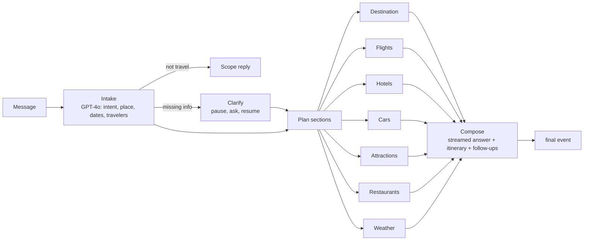

# TravelBuddy: AI trip planner

[](https://travelbuddy.live)
[](https://www.python.org/)
[](https://fastapi.tiangolo.com/)
[](https://react.dev/)
[](https://langchain-ai.github.io/langgraph/)
[](https://openai.com/)
[](LICENSE)

Describe a trip in a sentence. TravelBuddy searches live flights, hotels, rental cars, places,
restaurants and weather, streams back an answer as each search finishes, and builds a day-by-day
plan you can put on a map, add to your calendar, download as a PDF or share.

- **App:** https://travelbuddy.live
- **API docs (Swagger):** https://travelbuddy.live/docs
- **Source:** https://github.com/VishalPrasanna11/Travel_Buddy
- **Issues:** https://github.com/VishalPrasanna11/Travel_Buddy/issues

---

## Features

- **One conversation, whole trip.** "4 days in Lisbon from Boston, March 12–15, 2 adults" runs every search it needs in parallel and streams progress ("Flights ✓ 10 found · Hotels: searching…").
- **Real data only.** Flights, hotels and cars come from RouteStack, places and restaurants from Google Places (with photos and attribution), weather from OpenWeather. Prices are never invented; missing data is shown as missing.
- **Asks when it should.** Missing dates, origin or an ambiguous place ("which Portland?") get a quick question with tappable answers, then the plan continues.
- **Day-by-day itinerary.** Morning, afternoon and evening slots linked to real results, with "Day 2 on map", calendar export (.ics), PDF download and read-only share links.
- **Booking hand-off.** Book buttons open the provider's checkout for the exact flight, room or car.
- **Your account.** Trips sync across devices (Auth0 sign-in), with saved places, preferences (currency, units, home airport, travelers) and thumbs-up/down feedback.
- **Stays on topic.** Non-travel requests get a friendly redirect instead of an answer.

## How it works



The agent is a LangGraph `StateGraph` ([`server/agents/travel_graph.py`](server/agents/travel_graph.py)).
`POST /api/llm/ask` streams Server-Sent Events: `meta`, `agent` (per-search progress), `plan`,
`section` (each result set as soon as it's ready), `delta` (answer tokens), `clarification`,
`final` and typed `error`s. Clarifying questions use LangGraph `interrupt()` and resume with the
traveler's answers.

## Tech stack

| Layer | Tools |
|---|---|
| Frontend | React 19, TypeScript, Vite, Tailwind CSS 4, shadcn/ui, TanStack Query, Google Maps JS API, Auth0 |
| Backend | Python 3.11, FastAPI, LangGraph + LangChain OpenAI (GPT-4o), SQLAlchemy, PostgreSQL, fpdf2, Brotli |
| Data providers | RouteStack (flights, hotels, cars, checkout), Google Places (New), OpenWeather (One Call 3.0, free 5-day fallback) |
| Hosting | Heroku (Docker, `heroku.yml`), Heroku Postgres, custom domain with automatic TLS |

## Repository layout

```text
Travel_Buddy/
├── client/                 React app (Vite)
│   └── src/
│       ├── api/            API clients (SSE ask, conversations, account)
│       ├── components/     chat/ (cards, itinerary, follow-ups), map, sidebar, ui/
│       ├── hooks/          useChat + the SSE stream reducer
│       ├── pages/          home, chat, saved, settings, shared trip
│       └── global.css      design tokens (theme colours, type, motion)
├── server/                 FastAPI app
│   ├── agents/             LangGraph pipeline, SSE runner, test fixtures
│   ├── routes/             /api/* endpoints
│   ├── tools/              RouteStack, Google Places, OpenWeather clients
│   ├── schemas/            typed entities (Flight, Hotel, Place, WeatherDay…) and API models
│   ├── models/             SQLAlchemy tables (created on startup)
│   └── middlewares/        auth (Auth0 JWT), errors, request ids, rate limits
├── evals/                  AI eval plan, 38 test cases and the harness
├── docs/                   API upgrade plan and UI makeover notes
├── Dockerfile, heroku.yml  production image (client build + server)
└── docker-compose.yaml     local stack (server, client, Postgres)
```

## Run it locally

### Prerequisites

- Python 3.11, Node.js 22 and npm
- PostgreSQL (or `docker compose up postgres`)
- Keys: OpenAI, Google Maps / Places, RouteStack, OpenWeather; an Auth0 application and API

### 1. Clone and configure

```bash
git clone https://github.com/VishalPrasanna11/Travel_Buddy.git
cd Travel_Buddy
cp .env.example .env
cp client/.env.example client/.env
```

Fill in both files. The server reads `.env` (database, Auth0, OpenAI, Google, RouteStack,
OpenWeather). The client reads `client/.env` (Auth0 app, Google Maps key, and `VITE_BASE_URL`
pointing at the local server, e.g. `http://localhost:8000`).

### 2. Start the server

```bash
cd server
python -m venv .venv && source .venv/bin/activate
pip install -r requirements.txt
uvicorn main:app --reload --port 8000
```

Tables are created on startup. Swagger is at http://localhost:8000/docs.

### 3. Start the client

```bash
cd client
npm install --legacy-peer-deps
npm run dev
```

Open http://localhost:3000. Add `http://localhost:3000` to your Auth0 application's Allowed
Callback URLs, Logout URLs and Web Origins.

### Without API keys

Fixture mode serves realistic canned results so you can work on the UI offline:

```bash
cd server
TRAVELBUDDY_FIXTURES=1 ALLOW_ANONYMOUS_ASK=1 uvicorn main:app --port 8000
```

### With Docker

```bash
docker compose up --build
```

## API overview

All JSON errors look like `{"error": {"code", "message", "retryable", "request_id"}}`; every response carries `X-Request-ID`.

| Endpoint | Purpose |
|---|---|
| `POST /api/llm/ask` | Ask TravelBuddy (SSE stream); `resume` answers a clarification |
| `DELETE /api/llm/ask/{request_id}` | Stop an answer in flight |
| `GET/PATCH/DELETE /api/conversations[/{id}]` | Trip history (signed in) |
| `POST /api/book/{entity_id}` | Checkout link for a flight, hotel or car |
| `GET /api/places/photo/{ref}`, `GET /api/places/{place_id}` | Photo proxy, place details |
| `GET /api/trips/{id}/export?format=ics\|pdf` | Download the itinerary |
| `GET /api/trips/{id}/share`, `GET /api/shared/{token}` | Create / read a public share link |
| `GET/PATCH /api/users/preferences` | Locale, currency, units, home airport, travelers |
| `GET/POST/DELETE /api/saved-places` | Saved places, restaurants and hotels |
| `POST /api/feedback` | Thumbs up/down on an answer |
| `GET /api/health` | Health and version |

Full schemas: https://travelbuddy.live/docs (OpenAPI at `/openapi.json`).

## Testing the AI

[`evals/`](evals/README.md) holds the eval plan: 38 prompts across full plans, single requests,
clarifications, scope, multi-turn follow-ups, robustness and grounding, scored by deterministic
checks (stream contract, slots, sections, prices that must exist in the results) and an optional
GPT-4o judge.

```bash
# contract checks against a fixture-mode server
python evals/run_evals.py --base-url http://localhost:8000 --fixtures
# full suite against a live server, with the judge
python evals/run_evals.py --base-url http://localhost:8000 --judge
```

## Deployment

Pushes to `main` deploy to Heroku from [`heroku.yml`](heroku.yml): the Docker build compiles the
client, then serves it from FastAPI alongside the API. Config vars on the Heroku app:
`DATABASE_URL`, `AUTH0_DOMAIN`, `AUTH0_AUDIENCE`, `FRONTEND_URL`, `OPENAI_API_KEY`,
`GOOGLE_API_KEY`, `GOOGLE_MAPS_API_KEY`, `ROUTESTACK_*`, `OPENWEATHER_API_KEY`.
The client calls the API on its own origin, so the app works on `travelbuddy.live`,
`www.travelbuddy.live` and the Heroku URL alike.

## More docs

- [DESIGN.md](DESIGN.md): design system (colours, type, motion)
- [PRODUCT.md](PRODUCT.md): product principles
- [docs/api-upgrade-plan.html](docs/api-upgrade-plan.html): the five-phase API upgrade
- [docs/ui-makeover/](docs/ui-makeover/final-report.md): UI makeover findings and report

## Contributors

- Sai Priya Veerabomma
- Sai Srunith Silvery
- Vishal Prasanna

## License

MIT. See [LICENSE](LICENSE).
